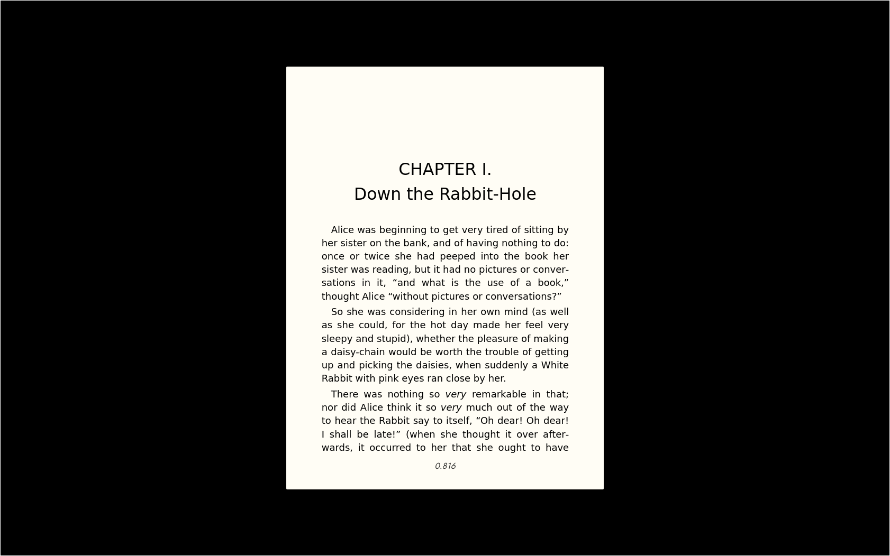
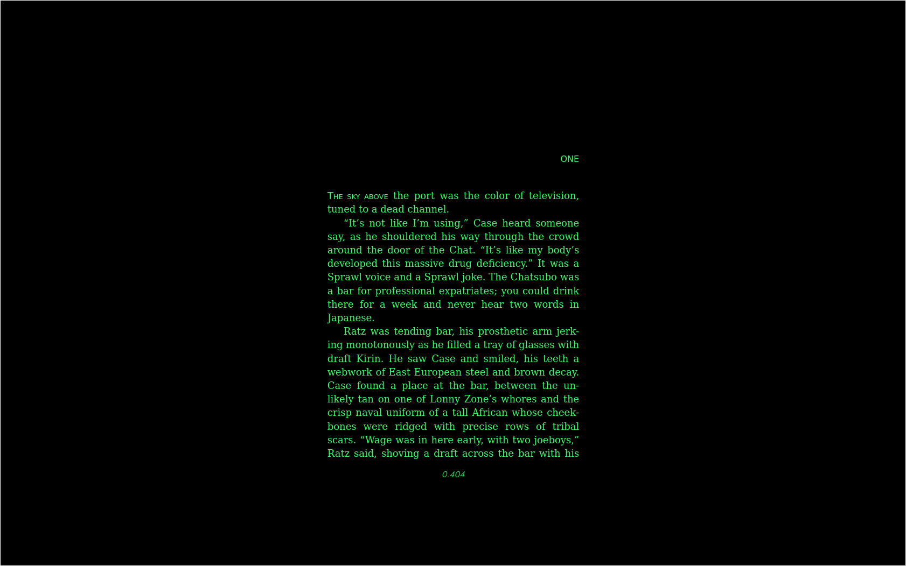

# SM reader
Mirror or old MS (Microsoft) book reader, with white page on black background

Mobile and desktop.

To install point your browser to https://dbojan.github.io/smreader/ , and wait for "Install complete" message at the bottom. You can use the app offline afterwards.

You can also run your own server, and install using localhost: `python3 -m http.server 7777`

On Linux/Chromium don't use double click to open import file, use 'Open file' button when importing books, doubleclick somehow auto fires cancel.

Menu and position are hide-able.

"*A thing of beauty is a joy for ever ...*"

John Keats, Endymion

